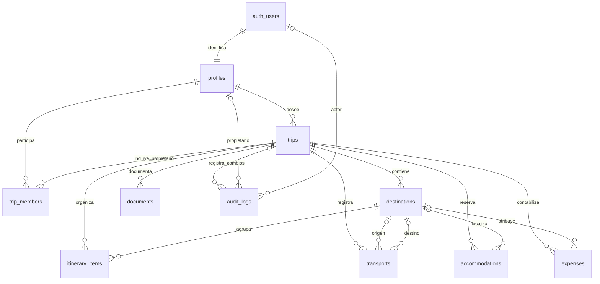

# Plan de desarrollo: Travel Planner

Resumen operativo de `PLAN_MAESTRO_TRAVEL_PLANNER.docx`.

**Stack:** Next.js (App Router) + React + TypeScript estricto + Tailwind + Supabase (Auth, Postgres, Storage, RLS) + MapLibre + Vercel.
**Enfoque:** monolito modular, MVP personal y modelo preparado para multiusuario. Se avanza por fases con validación antes de pasar a la siguiente.

## Fases

| Fase | Objetivo | Entregables principales | Criterio de cierre |
|---|---|---|---|
| **0. Preparación** | Base técnica | Comprobar Node, npm y Git. Inicializar Next.js, TS, Tailwind, ESLint. Estructura de carpetas, `.env.example`, README | Arranca en local y `lint`, `tsc` y `build` pasan |
| **1. Diseño y estructura** | Experiencia visual | Layout, navegación lateral (escritorio) y móvil, tema claro/oscuro, componentes UI, dashboard y detalle de viaje con datos ficticios, estados vacíos y de carga | Interfaz navegable y coherente con mocks |
| **2. Supabase y auth** | Backend conectado | Clientes Supabase servidor/navegador, registro, login, logout, recuperar contraseña, rutas protegidas, perfiles | Registro y acceso al espacio privado |
| **3. BD y seguridad** | Modelo definitivo | ERD, migraciones, índices, restricciones, RLS, seed | Las políticas bloquean accesos no autorizados |
| **4. Viajes** | Núcleo | CRUD y archivado de viajes, dashboard real, próximo viaje, anteriores y futuros | Los viajes persisten y son del usuario |
| **5. Destinos e itinerario** | Contenido | CRUD y reordenación de destinos, actividades por día | Varios destinos, cada uno con su itinerario |
| **6. Transportes y alojamientos** | Reservas | CRUD de ambos, vínculo con destinos, vista cronológica | Consulta de todos los desplazamientos y alojamientos |
| **7. Presupuesto y gastos** | Costes | Presupuesto, gastos (`NUMERIC`, moneda original), totales y distribución por categoría y destino | Importes exactos, sin pérdida de precisión |
| **8. Documentos** | Archivos | Storage privado, subida, descarga, borrado, URLs firmadas | Almacenar y recuperar documentos de forma segura |
| **9. Mapas y móvil** | Durante el viaje | MapLibre, destinos, actividades y alojamientos, rutas, evaluar Capacitor | Consulta visual de los lugares del viaje |

## Transversal

- Tests unitarios, de integración y E2E (incluido el aislamiento entre usuarios).
- Validación de formularios en cliente y servidor.
- Accesibilidad básica y diseño responsive.
- Repositorio en GitHub; despliegue continuo con Vercel y Supabase más adelante.

## Fuera del MVP

- Importación inteligente.
- Colaboración y roles.
- IA.
- Diario de viaje.
- Modo offline y app móvil.

## Decisiones confirmadas

- Gestor de paquetes: npm.
- Repositorio Git: https://github.com/santiagomoreta/TravelApp.
- Next.js directamente en `TravelProject`, con nombre de paquete `travel-planner`.
- Modelo de datos de la Fase 3 aprobado por el usuario el 16/11/2026.
- Fase 3 completada el 16/11/2026: migraciones aplicadas, perfil persistente e
	aislamiento entre cuentas confirmado manualmente por el usuario en Supabase.
- Fase 4 aprobada por el usuario e implementada el 16/11/2026: viajes persistidos
  y flujo completo comprobado con su sesión real en Supabase.
- Fase 5 aprobada y completada el 16/11/2026: tercera migración aplicada por el
	usuario y ciclo completo de destinos e itinerario verificado en Cloud.
- Fase 6 aprobada y completada el 16/11/2026: cuarta migración aplicada por el
	usuario y ciclo de reservas verificado en Cloud, incluidos importes exactos.
- Fase 7 aprobada y completada el 16/11/2026: quinta migración aplicada por el
	usuario y ciclo de presupuesto, gastos y conversiones verificado en Cloud.
- Fase 8 aprobada y completada el 16/11/2026: sexta migración aplicada por el
	usuario y ciclo Cloud validado, con los límites registrados al final del plan.
- Fase 9 completada: séptima migración ejecutada por el usuario y ciclo Cloud
	de coordenadas de actividades verificado. En ese cierre quedaron aplicadas
	las primeras siete migraciones; no repetir ninguna ni ejecutar seed.
- Ampliación autorizada: búsqueda por nombre/dirección y selección visual en los
	tres formularios; coordenadas internas, sin pedirlas al cliente.
- Mejora 1 completada el 17/11/2026: origen y destino del viaje con sugerencias,
	ciudad del dispositivo opcional y ruta en Mapa. Octava migración ejecutada por
	el usuario y persistencia Cloud verificada. Las ocho migraciones están aplicadas.
- Mejora 2 completada el 17/11/2026: foto propia privada al crear/editar viaje.
	Novena migración confirmada por el usuario y ciclo Cloud verificado. Las nueve
	migraciones están aplicadas: no repetir ninguna ni ejecutar seed Cloud.
- Mejora 3 completada el 17/11/2026: transporte con tres campos principales y
	opciones desplegables, sin vinculaciones técnicas en la vista inicial. Guardado
	mínimo y edición completa comprobados en Cloud; sin nueva migración.
- Reservas predictivas completadas el 17/11/2026: origen y destino de transporte
	reutilizan el autocompletado de viajes. Alojamiento usa «Buscar hotel o dirección»,
	guarda dirección y coordenadas de la sugerencia y retira el selector de destino
	vinculado y el textarea de dirección. Datos anteriores conservados al editar;
	sin migración. Guardado, recarga, edición y aviso de búsqueda no seleccionada
	comprobados en Cloud; viaje temporal eliminado. Escritorio/móvil revisados,
	71 pruebas correctas, lint y tipos sin errores.
- Itinerario actualizado el 17/11/2026: botones separados «Añadir destino» y
	«Añadir actividad». La actividad se abre directamente por su nombre, fecha y
	horas de inicio/fin, sin crear destinos. Parada opcional en sección secundaria;
	ubicación predictiva reutilizada del formulario de viaje, con coordenadas y
	nombre contextual del lugar, sin sustituir el nombre de la actividad. País y
	región retirados de la edición visible y conservados en destinos existentes.
	Migración `supabase/migrations/202611170011_trip_activities.sql` aplicada por
	el usuario y confirmada el 17/11/2026: permite actividades sin parada y mantiene
	propiedad, RLS, fechas del viaje y validación de horarios. No volver a ejecutarla.
	Guardado sin parada, ubicación predictiva, coordenadas, notas, fecha y horas
	verificados en Cloud, con recarga y edición en un viaje temporal.
	Calendario visual pendiente de una ampliación posterior.
- Intervalo del itinerario completado el 17/11/2026: campos «Desde» y «Hasta»
	inicializados con el inicio y fin del viaje; filtro inclusivo con actividades
	agrupadas por fecha y ordenadas por horario. Mantiene filtro de destino y permite
	consultar un solo día. Nuevo destino con ubicación predictiva, coordenadas y
	aviso de búsqueda no seleccionada. Rango, extremos y persistencia del destino
	verificados en Cloud; viaje temporal eliminado, escritorio/móvil revisados,
	72 pruebas correctas y tipos sin errores. Sin nueva migración.
- Visor de documentos completado el 17/11/2026: icono del ojo para abrir PDF,
	JPEG y PNG en la app; paginación PDF, zoom, ajuste al ancho, carga, error y
	reintento. Descargar se mantiene como acción independiente. React-PDF 11.1
	y worker PDF.js local, sin visor externo. URLs privadas firmadas de 60 segundos,
	con comprobación del propietario, viaje, estado listo y ruta canónica.
	PDF de dos páginas y PNG comprobados en Cloud y móvil; PDF también en escritorio.
	Recuperación tras fallo de red y proporción de imagen al ampliar verificadas.
	Viaje temporal y adjuntos eliminados; viaje propio conservado. 74 pruebas,
	lint, tipos y build correctos. Sin nueva migración. No se afirma un nuevo E2E
	de guardado de descargas ni una prueba nueva con otra cuenta o navegador físico.

## Decisiones pendientes

1. Idiomas: base local en `src/lib/i18n.ts`, sin añadir una librería por ahora. Evaluar `next-intl` al incorporar traducciones completas.
2. Supabase Cloud configurado; acceso, edición del perfil y persistencia al recargar y volver a entrar confirmados por el usuario. Registro/confirmación de correo y recuperación de contraseña siguen sin confirmación explícita. Google continúa aplazado.

## Estado actual

- Fase 0 completada: base técnica, Git local y comprobaciones de lint, tipos y build.
- Fase 1 completada: dashboard y detalle con datos ficticios, navegación responsive,
	temas persistentes, componentes UI, estados vacíos, carga y error.
- Fase 4 completada: creación, consulta, edición, archivado, restauración y borrado
	de viajes en Supabase. Dashboard real, búsqueda y filtros de próximos, pasados,
	todos los no archivados y archivados. Los viajes persisten al recargar.
- Fase 5 completada: destinos ordenables y agenda diaria con actividades,
  lugares, notas y zonas horarias. Pruebas locales y ciclo Cloud superados.
- Fase 6 completada: CRUD de reservas, vínculos y cronología, con validación
	local y guardado, recarga, edición, filtros y borrados comprobados en Cloud.
- Fase 7 completada: presupuesto, gastos, conversión manual, totales exactos y
	distribución, con validación local y ciclo completo de persistencia en Cloud.
- Fase 8 completada: documentos privados, validación de formato, descarga
	firmada y limpieza reintentable. Validación local y ciclo Cloud superados;
	guardado del adjunto confirmado manualmente por el usuario. Sin nueva prueba
	con una segunda cuenta Cloud en esta fase.
- Fase 9 completada: mapa, filtros y enlaces, con destinos, alojamientos y
	coordenadas de actividades comprobados en Cloud. Búsqueda visual validada en
	desarrollo/producción y móvil/escritorio; Capacitor evaluado y aplazado.
- Mejora 1 completada: nuevos viajes con origen y llegada seleccionados,
	autocompletado, ubicación opcional, marcadores O/D y trazado esquemático.
	59 pruebas, lint, tipos y build correctos; ciclo Cloud y navegador verificados.
- Mejora 2 completada: JPEG/PNG privado, vista previa, reemplazo y retirada;
	64 pruebas, lint, tipos y build correctos. Subida, edición sin reemplazo,
	recarga, retirada y eliminación de viaje con foto comprobadas en Cloud.
- Comprobados los flujos en navegador y la adaptación a móvil, tablet y escritorio.
- Fase 3 implementada y probada localmente: dos migraciones, diez tablas,
  restricciones, índices, triggers, RLS, auditoría y seed protegido para pruebas.
	Ambas migraciones ejecutadas por el usuario en Supabase Cloud sin errores.
	Perfil SQL activado; acceso anónimo rechazado en las diez tablas por la API.

## Siguiente paso

La **Fase 2** está implementada: clientes SSR, registro, acceso, recuperación,
callback, perfil inicial en Auth y cierre de sesión. Las rutas privadas verifican
la identidad en servidor. Las migraciones de Fase 3 se han ejecutado tanto en
PostgreSQL embebido desechable como en Supabase Cloud, según confirma el usuario.

El usuario confirma el acceso, cambio de nombre en el perfil y persistencia al
recargar, cerrar sesión y volver a entrar. Queda validar explícitamente el registro,
la confirmación del correo y la recuperación de contraseña.
Las comprobaciones automáticas no crean cuentas ni envían correos.

El usuario aprobó el modelo de la **Fase 3** y confirmó la ejecución de ambas
migraciones en PostgreSQL 17.12. `DATABASE_SCHEMA_READY=true` está activo y el
servidor reiniciado. Perfil autenticado y persistencia validados por el usuario.
El usuario también confirma que una segunda cuenta no puede consultar ni
modificar datos de la primera. Esta comprobación manual completa la validación
de la Fase 3, junto con las pruebas SQL locales y el rechazo anónimo remoto.
La Fase 4 fue aprobada y el flujo de viajes ya se ha comprobado con una sesión
real en Supabase. La **Fase 5: destinos e itinerario** está completada: tercera
migración aplicada y persistencia, edición, orden, filtros y borrados comprobados
con la sesión real. La **Fase 6: reservas** está completada: cuarta migración
aplicada y ciclo completo verificado, con precisión decimal y horarios multizona.
La **Fase 7** está completada: quinta migración aplicada y presupuesto/gastos
verificados en Cloud, con precisión decimal, conversiones, filtros y borrados.
La **Fase 8** está completada: el usuario confirmó la sexta migración y se verificó
el ciclo de documentos en Cloud. Las seis migraciones están aplicadas; no repetir
ninguna ni ejecutar seed. La **Fase 9: mapas y móvil** está completada: el usuario
confirmó la séptima migración y el ciclo Cloud de actividades ubicadas está
verificado. La mejora de origen/destino del 17/11/2026 también está completada:
el usuario confirmó la octava migración y el ciclo Cloud fue verificado. La mejora
de foto propia también está completada, con la novena migración confirmada y su
ciclo Cloud verificado. Las nueve migraciones están aplicadas; no repetir ninguna
ni ejecutar seed. Google
continúa aplazado. Los límites de validación quedan registrados; cualquier
ampliación o despliegue requiere aprobación.

## Fase 3: Modelo Implementado

**Estado:** modelo aprobado e implementado en migraciones; validación local superada.
Aplicado en Supabase Cloud; perfil autenticado validado por el usuario.
El usuario confirma el aislamiento entre dos cuentas reales. Fase completada.
La interfaz utiliza viajes reales desde la Fase 4. Este modelo cubre
las diez entidades del documento maestro sin implementar aún colaboración,
conversión automática de monedas, subida de archivos ni nuevas pantallas.

### Relaciones

`auth_users` representa la tabla existente `auth.users`, administrada por Supabase.

### Entidades Y Campos

Convenciones: PK UUID con `gen_random_uuid()` salvo `profiles.id`, que reutiliza
el UUID de Auth; `created_at` y `updated_at` como `timestamptz`, gestionados por
la BD. `audit_logs` solo lleva `created_at` porque es inmutable. Todas las tablas
de contenido llevan `trip_id NOT NULL`. En la tabla siguiente `?` indica nullable;
los demás campos son obligatorios, con los valores por defecto indicados.

| Tabla | Campos propuestos, además de los comunes | Claves y particularidades |
|---|---|---|
| `profiles` | `display_name text`, `avatar_url text?` | `id` PK y FK a `auth.users.id`; no duplicar correo ni credenciales de Auth |
| `trips` | `owner_id uuid`, `name text`, `description text?`, `start_date date`, `end_date date`, `cover_url text?`, `status text = planning`, `currency text`, `budget numeric(20,6)?`, `archived_at timestamptz?` | FK `owner_id -> profiles.id`; propietario inmutable en el MVP; país y destinos se derivan de `destinations`, no de un país único del viaje |
| `trip_members` | `trip_id uuid`, `user_id uuid`, `role text = owner` | FKs a viajes y perfiles; `UNIQUE(trip_id, user_id)` y un único owner por viaje; solo membresía del propietario en el MVP |
| `destinations` | `trip_id uuid`, `name text`, `country_code text?`, `region text?`, `arrival_date date`, `departure_date date`, `latitude numeric(9,6)?`, `longitude numeric(9,6)?`, `time_zone text?`, `image_url text?`, `description text?`, `position integer` | País como código ISO de dos letras; zona IANA cuando se conozca; `UNIQUE(id, trip_id)` para referencias compuestas |
| `itinerary_items` | `trip_id uuid`, `destination_id uuid`, `title text`, `description text?`, `local_date date`, `starts_at timestamptz?`, `ends_at timestamptz?`, `time_zone text?`, `location text?`, `latitude numeric(9,6)?`, `longitude numeric(9,6)?`, `category text = other`, `notes text?`, `estimated_amount numeric(20,6)?`, `currency text?`, `position integer = 0` | Destino obligatorio; admite actividades sin hora; importe y moneda estimados deben aparecer juntos |
| `transports` | `trip_id uuid`, `origin_destination_id uuid?`, `destination_id uuid?`, `type text = other`, `origin_label text`, `destination_label text`, `departs_at timestamptz?`, `arrives_at timestamptz?`, `departure_time_zone text?`, `arrival_time_zone text?`, `company text?`, `booking_reference text?`, `ticket_number text?`, `amount numeric(20,6)?`, `currency text?`, `notes text?` | Cada extremo puede ser externo al itinerario, por ejemplo el aeropuerto de casa; etiquetas conservadas aunque se desvincule un destino |
| `accommodations` | `trip_id uuid`, `destination_id uuid?`, `name text`, `type text = other`, `address text?`, `latitude numeric(9,6)?`, `longitude numeric(9,6)?`, `check_in date`, `check_out date`, `time_zone text?`, `amount numeric(20,6)?`, `currency text?`, `booking_reference text?`, `phone text?`, `url text?`, `notes text?` | Reservas con al menos una noche; precios opcionales, siempre con su moneda |
| `expenses` | `trip_id uuid`, `destination_id uuid?`, `concept text`, `amount numeric(20,6)`, `currency text`, `expense_date date`, `category text = other`, `notes text?`, `exchange_rate numeric(24,12)?`, `rate_date date?`, `base_currency text?`, `converted_amount numeric(20,6)?` | Importe original obligatorio; conversión opcional como instantánea, con campos de tasa, fecha y moneda base presentes juntos; importe convertido calculado por la BD |
| `documents` | `trip_id uuid`, `uploaded_by uuid`, `name text`, `category text = other`, `bucket_id text = trip-documents`, `object_path text`, `mime_type text`, `size_bytes bigint` | FK `uploaded_by -> profiles.id`; `UNIQUE(bucket_id, object_path)`; metadatos, nunca URL pública o firmada persistida |
| `audit_logs` | `trip_id uuid?`, `owner_id uuid?`, `actor_id uuid?`, `entity_type text`, `entity_id uuid`, `action text`, `summary jsonb = {}` | Referencias nullable para conservar un evento tras borrar el viaje; actor desde `auth.uid()`, nunca desde el cliente; resumen con campos permitidos, sin documentos, tokens ni localizadores |

### Integridad

- Nombres y títulos no vacíos tras `trim`; perfil de 2 a 80 caracteres, viaje y
	títulos de 1 a 160. Descripciones y notas con límites explícitos en SQL y Zod.
- Estados de viaje: `planning`, `upcoming`, `in_progress`, `completed`, `cancelled`.
	Archivar es independiente del estado. Las vistas de próximos y anteriores se
	calculan por fechas y excluyen cancelados o archivados, según la vista.
- Roles reservados: `owner`, `editor`, `viewer`. Reservar los valores no concede
	permisos: no habrá altas de editores, lectores ni invitaciones en esta fase.
- Categorías de itinerario: `sightseeing`, `restaurant`, `transport`,
	`accommodation`, `activity`, `excursion`, `free_time`, `other`.
	Transportes: `plane`, `train`, `bus`, `car`, `boat`, `taxi`, `other`.
	Alojamientos: `hotel`, `apartment`, `hostel`, `camping`, `guesthouse`, `other`.
	Gastos: `transport`, `accommodation`, `food`, `activities`, `shopping`, `other`.
	Documentos: `ticket`, `reservation`, `passport`, `insurance`, `other`.
- Fechas de viaje y destino: fin >= inicio; alojamiento: salida > entrada.
	Fin de una actividad o transporte >= comienzo si ambos existen. Una hora
	final requiere hora inicial; cada instante con hora requiere su zona IANA.
	La fecha local de la actividad debe coincidir con su comienzo en esa zona,
	no con la fecha UTC. No usar fechas UTC para interpretar reservas locales.
- Las fechas de destinos y días de itinerario deben caber en sus padres.
	Validar también al editar las fechas del viaje o destino: al ser reglas entre
	filas, necesitan triggers de restricción diferibles y validación de servidor,
	no un `CHECK` que consulte otras tablas. Las reservas se validan en su zona local.
- Latitud entre -90 y 90 y longitud entre -180 y 180; ambas nulas o ambas presentes.
	Posiciones >= 0; `UNIQUE(trip_id, position)` en destinos, diferible para
	reordenarlos en una transacción sin colisiones temporales.
- Toda FK desde contenido a un destino incluirá `(destination_id, trip_id)`
	contra `destinations(id, trip_id)`, también para el origen del transporte.
	Así se impiden referencias a otro viaje incluso si ambos pertenecen al usuario.
- Importes no negativos; monedas ISO 4217, tres letras mayúsculas, validadas
	también contra el catálogo admitido en servidor. Nunca `FLOAT` para dinero.
	Transmitir los `NUMERIC` como cadenas decimales en la futura capa de datos;
	no convertirlos a `number` para sumar o convertir divisas en JavaScript.
- Tasa de conversión > 0, expresada como unidades de moneda base por unidad
	original. `converted_amount` será generado como `round(amount * exchange_rate, 6)`.
	No sumar monedas distintas sin conversión: mostrar los importes sin convertir
	por separado. Cambiar la moneda del viaje exigirá revisar las conversiones.
- Presupuesto, costes estimados y precios de reservas no cuentan como gastos:
	solo `expenses` alimenta el total gastado, evitando contar una reserva dos veces.
- Crear el viaje y su membresía owner en la misma transacción mediante un
	trigger. Un trigger de integridad comprobará que el único owner coincide con
	`trips.owner_id`; no se permiten cambios de propietario ni de membresías desde
	el cliente en el MVP.
- Crear perfiles para usuarios existentes y nuevos, con nombre inicial desde
	`display_name`, `full_name` o `name`, saneado y con fallback `Viajero`.
	La inserción desde Auth debe ser idempotente y no fallar por metadatos inválidos.
	Conectar lectura y edición del perfil a `profiles` en la implementación;
	los metadatos de Auth dejarán de ser la fuente del nombre editable.

### Eliminación E Índices

- Borrar un viaje elimina su contenido y membresías por cascada. El archivado
	no borra filas. Solicitar confirmación de borrado en la futura interfaz.
- Borrar un destino elimina sus actividades; gastos, alojamientos y extremos
	de transportes se conservan desvinculando únicamente la columna del destino,
	nunca `trip_id`. Las FKs compuestas deberán usar `SET NULL` dirigido a esa
	columna. Verificar soporte de la versión PostgreSQL del proyecto antes del SQL.
- Borrar un usuario elimina su perfil; si posee viajes, la FK del propietario
	bloquea la eliminación hasta una limpieza explícita y controlada. No se
	implementa todavía el cierre de cuenta ni se borra ningún usuario existente.
- Los logs no se borran con el viaje: `trip_id` pasa a NULL y conservan `entity_id`.
	Al eliminar sus identidades, `owner_id` y `actor_id` pasan a NULL. No registrar
	copias completas de filas con información sensible.
- Los objetos de Storage no se borran por cascadas SQL. La Fase 8 deberá resolver
	la limpieza idempotente de archivos y metadatos antes de permitir esas operaciones
	con archivos reales. La Fase 3 no crea un bucket ni habilita subidas.
- Indexar las FKs: todos los `trip_id`, `trips.owner_id`, membresías por `user_id`,
	destinos referenciados, `documents.uploaded_by` y propietarios/actores de logs.
	Añadir `(owner_id, start_date)` en viajes no archivados, `(destination_id,
	local_date, position)` en itinerario, `(trip_id, departs_at)` en transportes,
	`(trip_id, check_in)` en alojamientos, `(trip_id, expense_date)` en gastos,
	`(trip_id, created_at)` en documentos y logs. No duplicar índices de PK o UNIQUE.

### Acceso Y Seguridad

| Tabla o grupo | Lectura | Alta, edición y borrado en el MVP |
|---|---|---|
| `profiles` | Solo el propio usuario | Alta desde Auth; usuario edita solo nombre/avatar; sin borrado directo |
| `trips` | Solo `owner_id = auth.uid()` | Alta con propietario propio; editar/borrar solo propios, sin transferir propiedad |
| `trip_members` | Solo membresías de viajes propios | Sin escritura directa; membresía owner administrada por trigger |
| Destinos, actividades, transportes, alojamientos, gastos y documentos | Solo si el viaje pertenece al usuario | `USING` comprueba la fila anterior y `WITH CHECK` el viaje de destino; relaciones protegidas por FK compuesta |
| `audit_logs` | Solo `owner_id = auth.uid()` | Sin escritura directa; inserción desde triggers de operaciones autorizadas; sin editar/borrar eventos |

- Activar RLS en las diez tablas; políticas para `authenticated` y sin acceso
	anónimo. Limitar además `GRANT` por tabla/columna: RLS no protege por sí solo
	las columnas inmutables. Usar `(select auth.uid())` en las políticas pertinentes.
- Basar el acceso al contenido en la propiedad de `trips`, no en metadatos de
	Auth ni en un `user_id` enviado por el formulario. La futura colaboración
	requerirá una migración explícita de políticas, no solo crear membresías.
- En documentos, exigir `uploaded_by = auth.uid()` al insertar e impedir su
	modificación posterior. El permiso sobre un viaje no autoriza a atribuir
	una subida a otra persona; el actor de auditoría también lo fija la BD.
- Evitar políticas recursivas: las de viajes solo consultan su propietario;
	las del contenido consultan viajes y no vuelven a consultar el contenido.
- Funciones de trigger privilegiadas con `search_path` fijo, objetos cualificados,
	permisos mínimos y sin ejecución directa por `anon`/`authenticated` cuando
	no corresponda. Nunca exponer `service_role` ni usarlo en las operaciones normales.
- `documents` queda protegido como metadatos; esto no protege automáticamente
	`storage.objects`. En la Fase 8: bucket privado, ruta
	`<user_id>/<trip_id>/<document_id>/<archivo>`, comprobación del propietario y
	URLs firmadas de corta duración. Prohibir rutas ajenas, públicas o arbitrarias.

### Secuencia De Implementación

1. Comprobar la versión de PostgreSQL y el estado de tablas del proyecto, sin
	 leer secretos ni modificar datos. Preparar migraciones versionadas en
	 `supabase/migrations`; no aplicar cambios remotos sin confirmar el destino.
2. Crear perfiles y backfill idempotente desde Auth, tablas, tipos/restricciones,
	 claves compuestas, índices y triggers. No recrear ni modificar `auth.users`.
3. Configurar privilegios, RLS y auditoría con denegación por defecto; actualizar
	 los tipos de la capa Supabase y conectar el perfil existente a su tabla.
4. Preparar `supabase/seed.sql` solo para pruebas locales: usuarios ficticios
	 deterministas y dos propietarios con viajes distintos. No copiar datos reales,
	 enviar correos ni ejecutar seeds contra Supabase Cloud automáticamente.
5. Ejecutar migración y pruebas de BD en un entorno local desechable compatible
	 con Supabase. Si falta CLI o Docker, comunicar el bloqueo antes de instalar
	 servicios o proponer ejecutar SQL en la nube.
6. Validar como anónimo y como usuarios A/B: negar lectura y escritura cruzadas,
	 suplantación del propietario, membresías y auditoría; permitir el CRUD propio.
	 Probar FKs cruzadas incluso entre dos viajes del mismo propietario, fechas,
	 importes, reordenación, cascadas y conservación de reservas al borrar destinos.
7. Probar trigger de perfil para usuarios existentes/nuevos y metadatos inválidos,
	 persistencia del nombre y regresión de la autenticación. Ejecutar tests,
	 lint, tipos y build. No declarar RLS verificado solo por inspeccionar SQL.

**Fase 3 completada (16/11/2026):** migraciones ejecutadas en Supabase Cloud,
integridad y RLS comprobados con PostgreSQL local, acceso anónimo remoto
rechazado y perfil/aislamiento entre cuentas validados manualmente por el usuario.
La prueba manual no constituye una suite E2E automatizada contra Cloud ni una
prueba de concurrencia multi-conexión. La Fase 4 se implementa sobre este esquema,
sin volver a ejecutar las migraciones existentes.

### Evidencia Local Y Límites

- Migraciones: `supabase/migrations/202611160001_schema.sql` y
	`supabase/migrations/202611160002_security.sql`, ejecutadas en ese orden.
- Durante la Fase 3 Docker no tenía motor disponible. En la Fase 4,
  `docker info` confirma un motor 29.9.2 operativo. Se mantiene la suite
  PostgreSQL embebida existente; no se ha iniciado ni instalado infraestructura.
- Alternativa local: PGlite 0.5.16, PostgreSQL 18.6 en memoria. Las migraciones
	requieren PostgreSQL >= 15; el proyecto remoto usa PostgreSQL 17.12.
- `npm test` incluye las pruebas de Auth, validación de viajes y 16 pruebas de BD con roles SQL
	no privilegiados: anon, usuario A y usuario B. Cubre CRUD en las seis tablas
	de contenido, RLS, perfiles/backfill, metadatos inválidos, membresías, auditoría,
	FKs cruzadas, fechas locales, reordenación, dinero exacto, rechazo de NaN,
	documentos y cascadas. El seed se ejecuta dos veces para comprobar idempotencia.
- El fixture local reproduce solo `auth.users`, `auth.uid()` y los roles
	necesarios; no ejecuta GoTrue, PostgREST ni Storage. No prueba concurrencia
	multi-conexión ni sustituye una validación con Supabase real o Docker.
- Tipos de las diez tablas en `src/lib/supabase/database.types.ts`; cliente
	de servidor tipado y lectura/edición de perfil preparadas. Sin activar
	`DATABASE_SCHEMA_READY`, el perfil continúa usando los metadatos de Auth.
	Con el interruptor activo no hay fallback silencioso si falla `profiles`.
- Tras confirmar ambas migraciones, se añadió únicamente `DATABASE_SCHEMA_READY=true`
	a `.env.local`, sin leer ni modificar las credenciales, y se reinició Next.js.
	La API remota devuelve 401 / 42501 para las diez tablas sin sesión.
- No se han creado cuentas remotas de prueba, enviado correos, configurado
	Google, creado buckets ni aplicado seeds en la nube.

## Fase 4: Viajes Persistentes

**Estado:** implementada y verificada el 16/11/2026. Sin nuevas migraciones.

- Lectura desde Supabase en servidor y datos serializados al espacio privado;
	no se utilizan los viajes ficticios en las vistas.
- Acciones de servidor con identidad verificada, propietario obtenido de la sesión,
	filtros explícitos por propietario, RLS y revalidación del layout tras mutaciones.
- Formulario compartido de creación/edición: nombre, descripción, fechas,
	estado, moneda y portada opcional entre las fotografías locales disponibles.
	Validación cliente/servidor, indicadores de espera y conservación de campos
	tras un error. No crea destinos ni modifica importes monetarios existentes.
- Archivado reversible y separado del estado; los archivados se excluyen del
	dashboard. Borrado permanente con confirmación y cascadas del esquema existente.
- Listado con búsqueda por nombre/destino, próximos (incluye viajes en curso),
	pasados, todos los no archivados y archivados. Los cancelados no son próximos;
	los completados se clasifican como pasados.
- Resumen con próximo viaje, cuenta atrás, destinos y viajes anteriores reales.
	Detalle con datos propios y estados vacíos, sin reservas ni finanzas inventadas.

### Estrategia Y Evidencia De Validación

- Aplicación: Next.js SSR con componentes cliente y Server Actions.
- Recorridos: crear/recargar, editar/recargar, archivar/restaurar, buscar/filtrar,
	validación y borrado con confirmación. Aislamiento adicional con roles A/B en SQL.
- Suite reproducible: `npm test`, 26 pruebas correctas (7 Auth, 16 PostgreSQL,
	3 validación/filtros de viajes), código 0, sin omitidas. PGlite ejecuta las
	migraciones reales con un esquema Auth mínimo; los fixtures no acceden a Cloud.
- La nueva prueba SQL recorre todo el ciclo y comprueba que las ediciones
	conservan exactamente un presupuesto existente y que otro usuario no puede
	consultar, editar, archivar, restaurar ni eliminar el viaje.
- `npm run lint`, `npm run typecheck` y `npm run build`: código 0.
- E2E puntual con Playwright sobre Supabase real, con la sesión iniciada por el
	usuario: creación y persistencia tras recargar, edición de nombre/descripción/
	fechas/estado/moneda/portada, archivado persistente, restauración, búsqueda,
	filtros de futuros y pasados, validación sin perder campos y borrado confirmado.
- Capturas revisadas en móvil (390 x 844) y escritorio (1440 x 960), imágenes
	cargadas y ausencia de desbordamiento horizontal. Formulario inicial también
	revisado en escritorio. El único viaje temporal creado se eliminó al terminar;
	sus eventos de auditoría se conservan según el diseño.
- Límites: los scripts del navegador se ejecutaron de forma puntual, no son una
	suite E2E guardada. No se repitió el flujo Cloud con una segunda sesión en esta
	fase; se mantiene la confirmación manual de Fase 3 y la cobertura SQL A/B.
	No se simularon fallos de red ni concurrencia multi-conexión. La prueba Cloud
	usa Supabase/PostgreSQL 17.12; PGlite/PostgreSQL 18.6 no ejecuta GoTrue/PostgREST.

**Cierre de Fase 4:** viajes persistidos y ciclo completo validado. La Fase 5
fue aprobada posteriormente y se detalla a continuación.

## Fase 5: Destinos E Itinerario

**Estado:** completada el 16/11/2026. Migración aplicada y ciclo completo
validado en Cloud, además de las pruebas locales.

- Destinos: nombre, país/región, fechas, coordenadas opcionales emparejadas,
	zona horaria y descripción; alta, edición, orden y borrado confirmado.
- Agenda por día y destino, navegación limitada a las fechas del viaje.
	Actividades con categoría, fecha local, horario opcional, zona, lugar,
	descripción y notas; alta, edición y borrado confirmado.
- Formularios con validación cliente/servidor, campos conservados tras error,
	estados pendientes, anuncios accesibles y controles responsive.
- Migración `202611160003_trip_content.sql`: tres funciones SECURITY INVOKER,
	acceso solo authenticated, RLS intacta y bloqueo del viaje para posiciones.
	Reordenación atómica; las ediciones no cambian importes monetarios existentes.
- PostgreSQL convierte horarios locales y rechaza horas inexistentes por DST.
	Horas repetidas: resolución estándar de PostgreSQL, sin selector de repetición.
	Eliminar destino borra sus actividades, pero conserva reservas/gastos desvinculados.

### Evidencia Y Cierre

- `npm test`: 30 correctas, ninguna omitida (7 Auth, 17 PostgreSQL,
	3 modelo de viajes y 3 modelo de contenido). Lint, tipos y build: código 0.
- Prueba SQL con las tres migraciones: alta/edición, intercambio de posiciones,
	límite del orden y dirección inválida, horarios y DST, cascada, aislamiento
	propio/ajeno/anónimo y conservación exacta de un importe al editar actividad.
- El usuario confirma la tercera migración en SQL Editor: `Success. No rows returned`.
	No volver a ejecutar ninguna migración aplicada, ni seed, ni modificar claves.
- Navegador con sesión real: alta/recarga de dos destinos, edición conservando
	coordenadas y reordenación persistente; actividades con y sin horario,
	edición/recarga de horarios Europe/Madrid, descripción y notas; filtros por
	destino y día. Hora inexistente del 28/03/2027 rechazada en servidor sin perder
	título, categoría ni notas; corrección guardada y persistida.
- Borrado individual de actividad y de destino con cascada, confirmados tras
	recargar y sin afectar al otro destino. Viaje temporal eliminado al terminar,
	lista a cero y auditoría conservada. Sin nuevas cuentas ni lectura de claves.
- Capturas con datos revisadas en escritorio y formulario móvil; sin desbordamiento
	a 390/1440 px, selectores/opciones móviles a 16 px. Comprobaciones previas:
	agenda vacía, avance diario/límites y rechazo de fechas fuera del viaje.
- Límites: PGlite/PostgreSQL 18.6 con Auth SQL mínimo no sustituye Cloud 17.12;
	sin pruebas multi-conexión ni suite E2E guardada. Flujo Cloud no repetido con
	segunda cuenta; aislamiento y conservación monetaria cubiertos por SQL local.
	Google aplazado. La Fase 6 fue aprobada posteriormente.

**Cierre de Fase 5:** destinos e itinerario persistidos, ordenables y validados.
La Fase 6 fue aprobada posteriormente y se detalla a continuación.

## Fase 6: Transportes Y Alojamientos

**Estado:** completada el 16/11/2026. El usuario confirma la ejecución correcta
de `202611160004_bookings.sql` en Supabase y el ciclo Cloud queda verificado.

- CRUD de transportes: tipos aprobados, etiquetas de origen/llegada conservadas,
	destinos opcionales en ambos extremos, horarios opcionales y sus zonas,
	compañía, localizador, billete, precio con moneda y notas.
- CRUD de alojamientos: tipos aprobados, destino opcional, fechas con al menos
	una noche, zona, dirección, coordenadas, teléfono, web HTTPS, localizador y notas.
- Cronología por día local de salida/entrada; transportes sin fecha al final.
	Filtros por tipo y destino, incluyendo el origen vinculado del transporte.
- Acciones autenticadas con verificación de propietario, RLS y confirmación de
	borrado. Campos conservados tras error; controles móviles de 16 px.
- Una RPC SECURITY INVOKER con bloqueo del viaje convierte las horas en PostgreSQL
	y mantiene las restricciones existentes. No añade tablas ni cambia RLS.
	Las horas inexistentes por DST se rechazan; las repetidas siguen PostgreSQL.
- Precio opcional hasta 14 enteros y 6 decimales: cadenas en entrada, lectura
	`amount::text` y formato sin coma flotante. No suma importes ni crea gastos.
	Borrar un destino conserva reservas y etiquetas, desvinculando referencias.

### Estrategia Y Evidencia De Validación

- Aplicación: Next.js SSR/React y acciones; Supabase real para sesión y lecturas.
	Suite PostgreSQL existente con PGlite 18.6, Auth SQL mínimo y roles A/B/anónimo.
	Node 24.16.0 y Docker 29.9.2 disponibles, Playwright integrado operativo.
	No se presenta PGlite como Supabase completo ni como sustituto de Cloud 17.12.
- Recorridos de aceptación: CRUD y recarga de cada tipo, precios exactos, fechas
	multizona, vínculos/filtros/orden, borrados y conservación al eliminar destino.
	Datos SQL aislados por UUID y limpieza; navegador usa solo viaje temporal propio.
- `npm test`: 35 correctas, cero fallos/omitidas (7 Auth, 18 PostgreSQL,
	3 viajes, 3 contenido, 4 reservas), código 0. Lint, tipos y build: código 0.
- Prueba SQL nueva: ambos CRUD, máximo decimal exacto, llegada local anterior
	pero instante posterior en otra zona, DST inexistente, fechas inválidas,
	referencias cruzadas, edición inexistente, aislamiento y desvinculación.
	También comprueba precio/horario vacíos y que no se crean gastos automáticamente.
- Navegador con sesión real: alta/recarga de transporte multizona, alojamiento
	y traslado sin horario/precio. Edición y recarga de lugares, compañía, billete,
	localizadores, contacto/web, fechas, notas, moneda y precio; coordenadas persistidas.
	Precio máximo `99999999999999.999999 EUR` conservado sin redondeo en toda la
	lectura/edición, y nuevo precio `0.123456 GBP` del alojamiento persistente.
- Rechazo en servidor de llegada anterior al instante de salida, hora inexistente
	por DST y alojamiento fuera de fechas del destino, sin perder campos. Corrección
	guardada. Filtros por tipo, ambos extremos del transporte y combinación; notas,
	orden local y reservas sin fecha al final comprobados con datos.
- Eliminar destino conserva reservas, etiquetas y precios desvinculados. Borrados
	individuales de transporte y alojamiento verificados tras recarga sin afectar
	otras reservas. Viaje temporal eliminado; Andorra intacto y auditoría conservada.
- Capturas con datos de escritorio y móvil revisadas; 390/1440 px sin desbordamiento
	y selector móvil a 16 px. Formularios/opciones móviles también comprobados antes
	de la activación. Sin nuevas cuentas ni lectura de claves.
- Veredicto: validación local y ciclo Cloud superados. Las cuatro primeras migraciones
	están aplicadas; no volver a ejecutarlas ni ejecutar seed.
- Límites: sin suite E2E guardada, concurrencia multi-conexión ni segunda sesión
	Cloud en esta fase. Google aplazado.

**Cierre de Fase 6:** transportes y alojamientos persistidos, editables,
filtrables y validados con precios exactos. La Fase 7 fue aprobada posteriormente.

## Fase 7: Presupuesto Y Gastos

**Estado:** completada el 16/11/2026. El usuario confirma la ejecución correcta
de `202611160005_finance.sql` en Supabase y el ciclo financiero queda verificado.

Presupuesto opcional en la moneda del viaje y CRUD de gastos reales con concepto,
fecha, categoría, destino opcional, notas e importe/moneda originales. La tasa
manual opcional es una instantánea (moneda base por unidad original) con fecha;
PostgreSQL calcula el importe convertido. Sin proveedor externo ni conversión
automática. Solo gastos alimentan los totales; reservas y estimaciones quedan fuera.
Resumen del presupuesto, contabilizado y disponible, pendientes por moneda y
distribución contabilizada por categoría/destino. Importes exactos como cadenas
y sumas/diferencias con `BigInt`, sin aritmética de coma flotante.

### Estrategia De Validación

- Reutilizar `npm test` (`node:test`, PGlite) y añadir pruebas del modelo y RPCs
	en los archivos de pruebas existentes o junto a ellos; base anterior: 35 pruebas.
- Flujos: presupuesto guardar/leer/borrar; gasto crear/leer/editar/borrar;
	conversión exacta/redondeo SQL; monedas pendientes sin mezcla; acceso ajeno/anónimo;
	destino ajeno rechazado y desvinculación sin pérdida; cambios de moneda detectados.
- SQL aislado por UUID y limpieza en `finally`, sin seed ni escrituras sobre viajes
	del usuario en Cloud. Mantener el PostgreSQL embebido existente; no equivale a
	Supabase completo ni prueba concurrencia multi-conexión. Verificar Node/Docker.
- Navegador Playwright sobre el servidor local con sesión Cloud: formularios,
	validación, estados, filtros, escritorio/móvil y ciclo completo con la quinta
	migración aplicada. Distinguir comprobaciones puntuales de una suite E2E guardada.
- Puertas: pruebas sin fallos, lint, typecheck y build. Documentar evidencia y
	límites en este plan y README, sin añadir informes o herramientas redundantes.
- No ejecutar de nuevo las cinco migraciones aplicadas, no tocar credenciales,
	no comenzar Fase 8. Google continúa aplazado.

### Implementación Y Evidencia

- Migración `202611160005_finance.sql`: una RPC SECURITY INVOKER para presupuesto
	y gasto, bloqueo del viaje propio y validación exacta de importe/tasa antes del
	cast. Moneda base decidida en servidor; rechazo de moneda del formulario obsoleta.
	Sin tablas ni cambios RLS. Trigger impide cambiar moneda con presupuesto existente;
	primero quitar y guardar el presupuesto y revisar las conversiones.
- Lecturas `budget::text`, `amount::text`, `exchange_rate::text`,
	`converted_amount::text`. PostgreSQL calcula conversión; `BigInt` suma/resta con
	seis decimales, admite totales mayores que una fila y saldo negativo sin pérdida.
- Resumen financiero en Resumen y Presupuesto; CRUD con confirmación, filtros por
	categoría/destino/moneda y búsqueda. Distribución solo contabilizada. Monedas sin
	conversión vigente por separado y saldo parcial explícito. Gastos admiten compras
	previas al viaje. Reservas/estimaciones no generan ni duplican gastos.
- Puertas: `npm test` 40 correctas/0 fallos/0 omitidas (7 Auth, 19 PostgreSQL,
	3 viajes, 3 contenido, 4 reservas, 4 gastos), lint/typecheck/build código 0.
	Node 24.16.0 y Docker 29.9.2 comprobados; PGlite 18.6 existente, sin sustituirlo
	por otra infraestructura ni atribuirle equivalencia con Supabase completo.
- Pruebas SQL: presupuesto máximo exacto, gasto crear/leer/editar/borrar,
	conversión exacta/redondeo (`0.1 * 1.234565 = 0.123457`), rechazo de precisión
	extra/overflow, moneda obsoleta, cambio con presupuesto/conversión existentes,
	propietario/ajeno/anónimo, destino de otro viaje y desvinculación sin pérdida.
- Modelo: monedas ISO, pares de tasa/fecha, sumas exactas por encima del límite de
	fila, saldo negativo fraccionario, separación de monedas y distribución por
	categoría/destino; una instantánea con otra moneda base no se contabiliza.
- Navegador Cloud real: presupuesto y gasto máximos `99999999999999.999999`
	conservados exactamente tras guardar/recargar/reabrir. Presupuesto editado,
	retirado y cero persistentes. Cuatro gastos creados/recargados; edición de
	concepto, importe, moneda, fecha, categoría, notas, tasa y fecha del cambio.
- Conversión SQL `0.1 * 1.234565 = 0.123457`; tasa editada `0.900000000001`
	leída sin alteración. Suma `0.1 + 0.2 = 0.3 EUR`, JPY pendientes separados,
	saldo parcial negativo y distribución por categoría/destino correctos.
- Servidor rechaza overflow de conversión y formulario con moneda esperada
	alterada/obsoleta, conservando campos. Cambio de moneda bloqueado por presupuesto
	y, tras retirarlo, por conversión. Al quitar ambos permite EUR a GBP, con
	reagrupación correcta de pendientes. Sin atribuir concurrencia a esta prueba.
- Diez combinaciones de filtros/búsqueda, incluidas sin vincular/sin resultados;
	totales globales invariables. Notas, orden por fecha editada y resumen financiero
	en ambas pestañas comprobados. Borrar destino conserva los cuatro gastos,
	tasa e importe convertido exactos; distribución pasa a sin vincular.
- Borrados individuales de gasto contabilizado y pendiente verificados tras
	recarga, con totales/pendientes actualizados y otros gastos intactos. Capturas
	con datos en escritorio/móvil revisadas: sin desbordamiento 390/1440 px,
	filas sin exceso de ancho y filtros móviles a 16 px. Formularios/opciones,
	precisión extra y tasa cero ya comprobados antes de la activación.
	Viaje temporal eliminado, Andorra intacto y auditoría conservada.
	Sin nuevas cuentas ni claves leídas; no fueron necesarios cambios de código.
- Veredicto: validación local y ciclo Cloud superados. Las cinco migraciones
	están aplicadas; no volver a ejecutarlas ni ejecutar seed.
- Límites: pruebas de navegador puntuales, sin suite E2E guardada, concurrencia
	multi-conexión ni nueva segunda sesión Cloud. Fase 8 sin iniciar.

**Cierre de Fase 7:** presupuesto y gastos persistidos, importes y tasas exactos,
conversiones, distribución y controles de moneda validados. Fase 8 aprobada posteriormente.

## Fase 8: Documentos

**Estado:** completada el 16/11/2026. Sexta migración confirmada por el usuario;
validación local y ciclo de documentos Cloud superados con los límites siguientes.

Bucket privado `trip-documents`, PDF/JPEG/PNG hasta 4 MiB, validación de contenido
en servidor y rutas generadas `<user_id>/<trip_id>/<document_id>/document.ext`.
Metadatos editables, categorías, búsqueda, descarga con URL firmada breve sin
persistirla, borrado confirmado y limpieza reintentable antes de eliminar viajes.
Sin service_role, URLs públicas, escáner antivirus ni previsualizador de contenido.

### Estrategia De Validación

- Reutilizar `npm test` (`node:test`, PGlite), base de 40 pruebas. Modelo: metadatos,
	identificadores/rutas, tamaño y tipos; contenido real con detector de formato.
- SQL: estados pending/ready/deleting, RPCs propietario/ajeno/anónimo, rutas y
	columnas protegidas, políticas Storage y guardas de borrado de documento/viaje.
	Fixture Storage mínima local; no equivale al servicio de archivos de Supabase.
- Fallos: subida interrumpida, finalización fallida, borrado parcial y reintento
	idempotente. Nunca borrar metadatos antes de confirmar la retirada del objeto.
- Navegador Playwright con sesión real, formularios/listado y escritorio/móvil.
	Si falta la sexta migración, comprobar aviso y conservación de campos; dejar
	subida/descarga/borrado Cloud pendientes de aplicación manual y prueba posterior.
- Puertas: pruebas sin fallos, lint, typecheck y build. Documentar evidencia y
	límites en PLAN/README. No repetir las cinco migraciones aplicadas, no seed Cloud,
	no leer claves, no crear cuentas ni comenzar Fase 9. Google continúa aplazado.

### Implementación Y Evidencias

- Migración `202611160006_documents.sql`: bucket privado de 4 MiB y tres MIME,
	metadatos con estados `pending/ready/deleting`, RPC autenticada con comprobación
	explícita de propietario y bloqueo del viaje. Inserción/borrado directo de
	documentos revocados; edición limitada a nombre/categoría. Políticas restrictivas
	también limitan otras políticas permisivas sobre este bucket, sin alterar otros.
- Subida: autenticación y viaje propio, tamaño/MIME y detección con `file-type`,
	reserva de metadatos, ruta generada sin nombre original, subida sin sobrescritura
	y finalización tras comprobar tamaño/MIME del objeto. Si falla, intenta limpiar;
	cualquier resto queda visible para reintentar su eliminación, nunca oculto.
- Descarga de filas listas con URL firmada de 60 segundos y nombre de adjunto
	saneado. No se guarda la URL ni se usa service_role. Detectar el formato no es
	validar toda la estructura del archivo ni analizar malware.
- Borrado: marcar, retirar objeto por su ruta guardada y eliminar metadatos solo
	cuando SQL confirma que no queda objeto. Antes de borrar un viaje se limpian
	sus documentos en lotes de hasta 20; si quedan o falla un paso, se conserva el
	viaje y el reintento continúa. Una guarda SQL rechaza cascadas con metadatos u
	objetos pendientes, incluidos objetos sin metadatos bajo el prefijo del viaje.
- Interfaz integrada con búsqueda/categoría, nombre editable, tamaño/tipo/fecha,
	descarga, borrado confirmado y estados de limpieza. Sin migración, el panel
	informa de activación pendiente sin impedir consultar las demás pestañas.
- `npm test`: 46 correctas, 0 fallos/omitidas (7 Auth, 20 PostgreSQL, 3 viajes,
	3 contenido, 4 reservas, 4 gastos y 5 documentos). Lint, typecheck y build: código 0.
	Auditoría de producción: 0 vulnerabilidades. Persisten los 7 avisos moderados
	de desarrollo ya conocidos, fuera del alcance de esta fase.
- SQL local: ciclo completo y reintentos, metadatos protegidos, aislamiento
	propietario/ajeno/anónimo incluso con política permisiva adicional, finalización
	sin objeto o tamaño incorrecto rechazada, borrado parcial y subidas tardías
	rechazados. Tests de orquestación comprueban fallos de retirada/finalización y
	conservación de metadatos. Fixture Storage mínima, no servicio Storage real.
- Navegador autenticado: PDF falso rechazado por servidor; archivo de 4 MiB
	llega al aviso explícito de migración sin perder nombre, categoría ni archivo.
	Exceso de tamaño y SVG rechazados. Cinco pestañas operativas tras recarga.
	Capturas 1440x960/390x844 sin desbordamiento, entradas/selectores móviles a 16 px.
	Único viaje temporal eliminado, Andorra intacto y auditoría conservada.
- Node 24.16.0 y Docker 29.9.2 disponibles. Suite PGlite 18.6 existente;
	sin concurrencia multi-conexión, servicio Storage completo, segunda sesión Cloud
	nueva ni suite E2E guardada. No se han leído claves, creado cuentas o ejecutado
	migraciones/seed en Cloud. Servidor local conservado en http://127.0.0.1:3000.

### Validación Cloud Y Cierre

El usuario confirmó la ejecución exitosa de `202611160006_documents.sql` en el
SQL Editor. Las seis migraciones están aplicadas: no repetir ninguna ni seed,
no cambiar claves ni `DATABASE_SCHEMA_READY=true`.

- Sesión real: crear un viaje temporal, subir PDF válido generado, PNG y JPEG
	generados con canvas, recargar y comprobar los tres documentos listos.
- Edición de nombre/categoría persistente tras recarga y reapertura. Siete
	combinaciones de búsqueda/categoría, con mayúsculas, espacios y resultados vacíos,
	devuelven las filas esperadas sin afectar los otros documentos.
- Descargas firmadas: HTTP 200 y contenido correcto PDF (588 bytes), PNG (firma
	de contenido comprobada, sin tamaño exacto registrado) y JPEG (1926 bytes).
	PDF/JPEG con `Content-Disposition: attachment` y nombres correctos.
	Sin firma, URL pública y ruta autenticada sin credenciales devuelven HTTP 400;
	son sondas anónimas HTTP, no una prueba con otra cuenta autenticada.
- Caducidad comprobada: PDF/JPEG emitidos antes de borrar el viaje devuelven
	HTTP 400 `InvalidJWT` por `exp` después de 66 segundos desde el inicio del flujo.
	El enlace ya emitido del PNG siguió sirviendo contenido inmediatamente después
	del borrado, incluso variando la URL; no se garantiza revocación inmediata ni
	purga de caché. Los enlaces son credenciales temporales hasta su vencimiento.
- Borrado individual del PNG confirmado tras recarga, conservando PDF/JPEG.
	Eliminar el viaje con los otros dos documentos asociados completa la limpieza
	exigida por las guardas SQL. Viaje temporal eliminado; solo Andorra permanece,
	sin modificaciones, con auditoría conservada. No se afirma borrado físico
	inmediato de copias/cachés del proveedor a partir de estas comprobaciones.
- Capturas con datos a 1440x960/390x844 revisadas, sin desbordamiento. Se corrigió
	el buscador móvil de documentos a 16 px y se verificó junto al selector tras
	recarga. Único cambio de aplicación durante esta confirmación: esa regla CSS.
- Puertas repetidas después del ajuste: 46 tests, 0 fallos/omitidas; lint,
	typecheck y build con código 0. Node 24.16.0 y Docker 29.9.2 disponibles.
- Límites: el navegador integrado no entrega el evento de descarga nativa
	(`waitForEvent('download')` agotó el plazo); su cliente HTTP tampoco admite
	`Storage.getCookies`. Se verificaron respuestas y bytes mediante fetch en la
	página y cabeceras de red, sin persistir URLs firmadas. El usuario confirmó el
	16/11/2026 que guardar el adjunto funciona correctamente en su navegador habitual.
	Esta confirmación es manual, no una prueba E2E automatizada.
	Sin nueva segunda sesión Cloud, concurrencia multi-conexión o suite E2E guardada.
	Aislamiento cubierto por SQL local y confirmación manual previa de Fase 3,
	no por una nueva prueba de dos cuentas contra Storage real.

**Cierre de Fase 8:** documentos persistidos, consulta/edición/filtros, respuesta
de descarga firmada con caducidad y limpieza de documento/viaje validados en Cloud.
Fase 9 fue aprobada posteriormente. No se han leído claves, creado cuentas ni repetido
migraciones o seed. Servidor conservado en http://127.0.0.1:3000.

## Fase 9: Mapas Y Móvil

Alcance aprobado: pestaña Mapa, MapLibre GL 6 con carga diferida en cliente,
destinos/actividades/alojamientos con coordenadas explícitas, filtros combinados,
selección, ajuste de vista, orden esquemático de destinos e indicaciones externas.
No se calculan rutas por carretera ni se geocodifican nombres automáticamente.
Las actividades no heredan la ubicación de su destino. Los lugares sin coordenadas
permanecen en el listado. Adaptación responsive y evaluación de Capacitor, no
implementación de app nativa, modo offline o despliegue.

Base cartográfica: teselas raster estándar de OpenStreetMap, atribución visible,
sin clave, precarga masiva, caché offline ni eliminación de Referer. Solo se carga
al abrir Mapa con lugares ubicados. El proveedor recibe IP y zona visualizada,
no las notas, nombres ni referencias de reservas. Servicio comunitario sin SLA;
revisar capacidad/proveedor antes de un despliegue público con tráfico significativo:
https://operations.osmfoundation.org/policies/tiles/ . «Cómo llegar» abre Google Maps
solo por clic explícito y envía únicamente las coordenadas del lugar.

### Estrategia De Validación

- Aplicación mixta SSR/React: mantener `npm test` con Node y la infraestructura
	PGlite desechable ya aprobada. No sustituirla ni confundirla con Supabase completo.
	Docker disponible en la fase anterior; volver a comprobarlo, no asumir ausencia.
- Tests del modelo: coordenadas cero/inválidas, pares opcionales, filtros por tipo,
	destino y día, checkout exclusivo, líneas sin saltar lugares desconocidos,
	antimeridiano y URL externa sin datos privados.
- SQL: migración 7 en la instancia desechable, guardado atómico de actividad y
	coordenadas, rechazo ajeno/anónimo, precisión y preservación de campos existentes.
	Cloud conserva las seis migraciones aplicadas; nunca repetirlas ni ejecutar seed.
- Playwright integrado con sesión real, sin instalar otra suite: crear un viaje
	temporal identificable, destinos y alojamiento, guardar/recargar, abrir mapa,
	comprobar teselas/canvas no vacío, selección, filtros y encaje en 1440/390 px.
	Probar error de teselas y fallback, sin falsear un mapa si WebGL no está disponible.
- Antes de activar la migración 7, comprobar rechazo explícito de coordenadas
	de actividades conservando formulario; actividades sin coordenadas siguen
	funcionando. Persistencia Cloud de coordenadas de actividades pendiente de que
	el usuario aplique únicamente la nueva migración y se repita ese flujo.
- Criterios: tests sin fallos/omitidos, lint/tipos/build correctos, auditoría de
	producción, controles móviles sin desbordamiento, lugares desconocidos accesibles
	y enlaces externos correctos. Borrar solo datos temporales, conservar Andorra.
- Límites: pruebas de navegador ad hoc, sin suite E2E guardada, nueva segunda
	sesión autenticada ni prueba multi-conexión; SQL local cubre accesos ajenos.
	No leer claves, crear usuarios, configurar Google, commits, remotos ni app nativa.

### Implementación Y Evidencias

- MapLibre GL 6.18.0, cargado al abrir Mapa con coordenadas. Worker ESM referenciado
	explícitamente mediante `new URL(..., import.meta.url)` para que Turbopack
	lo empaquete; verificado tanto con `next dev` como con `next start`.
- Marcadores accesibles, selección sincronizada con el listado y foco conservado
	al usar Enter. Zoom, desplazamiento y ajuste de vista; margen reservado para
	que los controles no cubran marcadores al encajar en móvil. Colores por tipo,
	atribución visible y línea discontinua opcional: orden, no ruta por carretera.
- Filtros de tipo/destino/día, listado sin coordenadas y estados sin coincidencias,
	carga, error de teselas y WebGL ausente. Reintento destruye/recrea el mapa;
	al desmontar se liberan mapa, marcadores y observador de tamaño.
- Las columnas de coordenadas ya existían. La migración nueva añade una RPC
	autenticada SECURITY INVOKER, bloquea el viaje propio y reutiliza el guardado
	de actividades existente dentro de la misma transacción; no modifica RLS ni
	las seis migraciones anteriores. Preserva campos financieros ajenos al formulario.
- Validación final: `npm test` 52 correctos, 0 fallos/omitidos; lint, tipos y
	build con código 0. Diagnósticos del editor sin errores; auditoría de producción
	0 vulnerabilidades. Los 7 avisos moderados de desarrollo preexistentes continúan.
	Node 24.16.0 y Docker 29.9.2 comprobados; PGlite 18.6, no Supabase completo.
- Navegador real: viaje temporal con tres destinos (dos ubicados), alojamiento
	ubicado y actividad sin coordenadas, guardados y recuperados tras recarga.
	Diez combinaciones de filtros, selección desde marcador/listado, teclado,
	zoom, desplazamiento, ajuste, enlaces y atribución correctos. Sin lugares
	ubicados no se solicitan teselas. Bloqueo de teselas mantiene listado/enlaces
	y reintentar recupera el mapa; ausencia simulada de WebGL muestra alternativa.
- Canvas WebGL no vacío comprobado mediante diversidad de píxeles en escritorio
	y móvil; capturas revisadas a 1440x960 y 390x844, temas claro/oscuro, sin
	desbordamiento horizontal, campos móviles de 16 px y marcadores separados de
	controles. También comprobado sobre el build final de producción en puerto
	3001; servidor temporal detenido, desarrollo conservado en puerto 3000.
- Antes de migración 7, coordenadas de actividad rechazadas con aviso explícito
	y campos conservados; al dejarlas vacías el guardado compatible funciona.
	Esta era la validación previa a la activación; el ciclo Cloud posterior está
	registrado en la confirmación y cierre al final de esta fase.
- Viaje temporal eliminado con guardas de ruta/nombre y confirmación; recarga
	final con un único viaje, Andorra intacto. Auditoría conservada. Sin nuevas
	cuentas, secretos leídos/cambiados, commits, remotos ni migraciones Cloud repetidas.

### Evaluación De Capacitor

Decisión: mantener la web responsive; no añadir Capacitor ni proyectos nativos
en esta fase. Capacitor empaqueta archivos web con un `index.html`; el proyecto
actual depende de SSR, cookies, Proxy y Server Actions, incompatibles con una
exportación estática directa. La configuración oficial indica que `server.url`
es para servidores live-reload, no para producción:
https://capacitorjs.com/docs/config . No recomendar un simple envoltorio remoto
como solución nativa de producción.

Una fase nativa futura requeriría cliente empaquetable y backend HTTPS con
contratos/autorización explícitos, callbacks/deep links de Auth, almacenamiento
seguro de sesión, descargas/archivos, áreas seguras y pruebas en dispositivos
iOS/Android. Offline, sincronización y mapas descargables necesitan diseño y
proveedor que los permita. Sin SDKs instalados ni compatibilidad nativa afirmada.

### Activación Confirmada

El usuario confirmó la ejecución de
[supabase/migrations/202611160007_activity_locations.sql](supabase/migrations/202611160007_activity_locations.sql)
en Supabase. Las siete migraciones están aplicadas: no repetir ninguna ni
ejecutar seed. No cambiar credenciales ni `DATABASE_SCHEMA_READY=true`.
Creación, edición, recarga y retirada de coordenadas de actividades verificadas
con sesión real; detalle en la confirmación y cierre Cloud al final de esta fase.

### Ampliación Autorizada: Búsqueda De Lugares

El usuario autorizó consultar un servicio externo tras señalar que el cliente no
conoce coordenadas. Selector común en destinos, actividades y alojamientos: búsqueda
por nombre/dirección al pulsar Buscar o Enter, resultados con contexto, selección,
ajuste por clic/arrastre y botón accesible «Usar centro del mapa». Coordenadas ocultas,
ubicación previa conservada al editar y retirada explícita. Completa nombres vacíos,
sin reemplazar los elegidos por el cliente. No busca automáticamente al escribir.

Photon es el proveedor inicial sin claves nuevas, con atribución OpenStreetMap.
Acción autenticada; solo envía la consulta escrita, no datos de cuenta, reservas,
notas ni documentos. Proveedor configurable por `GEOCODING_URL`, HTTPS y API Photon;
URL elegida por servidor, no por el cliente, sin seguir redirecciones. Timeout 6 s,
3-160 caracteres, máximo 5 resultados GeoJSON validados y coordenadas a 6 decimales.
La caché solo guarda consultas/resultados en memoria 15 minutos, hasta 100 entradas;
sin BD ni logs propios. Límite por proceso de 1 petición/1,2 s y sin simultáneas;
no es una cuota global distribuida. El proveedor ve consulta e IP del servidor.

Servidor demo Photon: uso moderado, sin SLA y sujeto a limitaciones/cambios:
https://github.com/komoot/photon#demo-server . Para tráfico significativo se requiere
proveedor compatible o instancia propia y límites distribuidos antes del despliegue.
No se utiliza Nominatim público ni se añade ninguna migración para la búsqueda.

Evidencia final de la ampliación: 55 tests correctos, 0 fallos/omitidos; lint,
tipos y build con código 0, editor sin errores y auditoría de producción limpia.
Tres tests nuevos cubren respuesta externa inválida, precisión/cero, datos descartados,
consulta mínima enviada, caché/cooldown y fallos de red/proveedor/configuración.
Navegador real en desarrollo/producción: Barcelona, ausencia de consultas al escribir,
selección, nombres respetados, ajuste por clic/arrastre/centro con teclado,
destino/alojamiento guardado y recargado, retirada persistente y error HTTP con
ubicación preservada y reintento correcto. Capturas/canvas no vacío a 1440/390 px,
sin desbordamiento y campo móvil de 16 px. Accesos anónimos/segunda sesión de búsqueda
no probados en navegador; la acción verifica sesión en servidor.

Antes de activar migración 7: actividad ubicada rechazada con aviso, nombre/punto
conservados; quitar ubicación permitía guardar con RPC compatible. La persistencia
Cloud se comprobó después, según el cierre siguiente. Viaje temporal eliminado con guardas
de ruta/nombre; Andorra y el nuevo Budapest conservados. Producción temporal 3001
detenida, desarrollo 3000 activo. Sin claves leídas/cambiadas, cuentas nuevas,
commits, remotos ni migraciones Cloud repetidas. Navegador ad hoc, sin suite E2E guardada.

### Confirmación Cloud Y Cierre (16/11/2026)

El usuario confirmó la migración 7 y se verificó con su sesión real:

- Viaje/destino temporales, actividad buscada como Sagrada Familia y guardada con
	coordenadas. Recarga y reapertura conservan el punto exacto y las notas.
- Marcador de actividad seleccionable en Mapa; selección desde el listado y
	enlace «Cómo llegar» con las mismas coordenadas persistidas.
- Edición del título y ubicación a Casa Batlló: ambos persisten tras recargar;
	notas intactas, marcador y enlace actualizados, sin coordenadas antiguas.
- Filtros de tipo/día correctos; capturas de actividad en móvil 390x844 y
	escritorio 1440x960, canvas con imagen real y sin desbordamiento comprobado.
- «Quitar ubicación», guardar y recargar deja ambos campos vacíos, conserva la
	actividad/notas y retira marcador/enlace. El lugar sigue listado sin coordenadas.
- Viaje temporal eliminado con guardas de ruta/nombre y confirmación; recarga final
	con Andorra y Budapest conservados. Auditoría retenida. Servidor de desarrollo
	conservado en http://127.0.0.1:3000.

Sin cambios de código en esta confirmación; se mantienen las 55 pruebas y gates
locales superados de la ampliación. No se repitió ninguna migración ni seed Cloud,
no se leyeron/cambiaron claves, crearon cuentas, commits o remotos. Navegador ad hoc,
sin nueva segunda cuenta Cloud, concurrencia multi-conexión o suite E2E guardada.
**Fase 9 completada**, incluida búsqueda por nombre/dirección. App nativa y offline
no implementados; Capacitor evaluado y aplazado. Google continúa aplazado.

## Mejora 1: Origen Y Destino Del Viaje (17/11/2026)

Solicitud autorizada: indicar salida y llegada al crear el viaje, proponer la
ciudad del dispositivo tras aceptar el permiso y permitir búsqueda predictiva
manual. Ambos lugares deben persistir y aparecer unidos en Mapa.

- Formulario nuevo con origen/destino obligatorios como lugares seleccionados.
	Sugerencias a partir de 3 caracteres y tras 1,5 s sin escribir, hasta 5 resultados,
	región/país conservados para distinguir homónimos, flechas/Enter/Escape y selección
	táctil. Cambiar el texto invalida el punto anterior; se exige elegir de nuevo.
- Solo se monta el formulario al abrir el diálogo. La ubicación se pide únicamente
	al abrir un viaje nuevo o pulsar «Usar mi ubicación»; no al visitar otras pantallas.
	Cerrar desmonta el formulario e invalida respuestas/temporizadores pendientes.
- Tras aceptar: posición aproximada redondeada a 3 decimales antes de salir del
	dispositivo, consulta autenticada a Photon `/reverse`, capa ciudad. Se propone
	el punto de ciudad devuelto por el proveedor, no se guarda el GPS del dispositivo.
	Respuesta tardía nunca reemplaza un origen que el cliente ya esté escribiendo.
- Denegación, error, ausencia de API o contexto inseguro mantienen entrada manual.
	La dirección Wi-Fi HTTP no permite GPS en navegadores móviles: se necesita HTTPS
	con certificado confiable. No se instalaron certificados ni se publicó un túnel.
- Origen/destino se guardan juntos en `trips.route`, JSON validado en servidor y SQL,
	con RLS de propietario y auditoría existentes. Viajes anteriores admiten ruta nula;
	editar otros campos no la borra. No se crean paradas ficticias del itinerario.
- Cabecera/tarjeta muestran la llegada aunque aún no haya paradas; búsqueda de
	viajes incluye origen/destino. Mapa con marcadores O/D, nombres, filtros, línea
	esquemática con cruce corto del antimeridiano y enlace de ruta completa en Google
	Maps. No calcula carreteras, tiempos o distancias. Reencuadre al cambiar tamaño.
- Consulta inversa y búsqueda comparten cuota por proceso; las posiciones no se
	guardan en caché. Siguen vigentes los límites de Photon demo y la ausencia de
	cuota distribuida/SLA. Solo consulta o posición aproximada se envían al proveedor;
	nunca notas, cuenta, documentos ni reservas. Sin claves nuevas.

El usuario confirmó la ejecución satisfactoria de
[supabase/migrations/202611170008_trip_routes.sql](supabase/migrations/202611170008_trip_routes.sql).
Las ocho migraciones están aplicadas: **no repetir ninguna ni ejecutar seed Cloud**.
No modificar credenciales ni `DATABASE_SCHEMA_READY=true`.

Validación final: **59 tests, 0 fallos/omitidos**, lint, tipos y build correctos.
Prueba SQL nueva de forma/coordenadas, escritura atómica, presupuesto intacto y
aislamiento propio/ajeno/anónimo. PostgreSQL desechable existente, no Supabase completo
ni concurrencia multi-conexión. Nuevas pruebas de modelo, búsqueda inversa y mapa.

Navegador con sesión real y Cloud: viaje temporal Barcelona-Madrid creado y
recargado; edición a València, región/país y descripción conservados tras recarga.
Puntos, selección, filtros y enlaces coherentes; línea verificada por píxeles y
retirada al desactivar la casilla. Capturas 1440/390 px, temas claro/oscuro,
canvas no vacío, sin desbordamiento ni marcadores bajo controles tras redimensionar.
Build de producción comprobado en puerto 3001 y servidor temporal detenido.

Geolocalización simulada, sin leer GPS real: permiso aceptado/denegado, contexto
inseguro, respuesta tardía y una sola petición al abrir en producción; consulta
Photon real para una posición pública de prueba. No prueba física de permisos GPS
en iOS/Android ni nueva segunda cuenta Cloud. Navegador ad hoc, sin suite E2E guardada.
Solo se eliminó el viaje temporal mediante guardas de ruta/nombre y confirmación;
Andorra existente al inicio conservado. Auditoría retenida. Desarrollo Wi-Fi en
puerto 3000 conservado. Sin migraciones repetidas, seeds Cloud, cuentas, secretos,
commits, remotos ni despliegue.

## Mejora 2: Foto Propia Del Viaje (17/11/2026)

Solicitud autorizada: subir una imagen propia al crear o editar un viaje para
usarla en su perfil. Se reutiliza la portada compartida por cabecera, tarjetas
y resumen; las imágenes incluidas siguen disponibles.

- Formulario con opción «Foto propia», archivo JPEG/PNG de hasta 4 MiB, vista previa
	local y controles para reemplazar/quitar. Conserva imagen guardada al editar
	otros campos, campos/archivo tras error y selección de ruta existente. URL de
	vista previa liberada al reemplazar/cerrar. Selector accesible, 4 columnas en
	escritorio/2 en móvil, nombre de archivo largo sin desbordar.
- Validación de tipo por contenido y límite en servidor reutilizando la utilidad
	de documentos; PDF, SVG, MIME falso, archivos vacíos o grandes rechazados.
	No escáner antimalware ni decodificación completa; EXIF no se elimina.
- Bucket privado `trip-covers`, ruta generada propietario/viaje/UUID.jpg|png.
	Restricción SQL vincula referencia al propietario y viaje reales. Políticas
	restrictivas de Storage impiden leer, insertar o borrar archivos ajenos incluso
	si otra política es permisiva; sin sobrescritura directa de objetos.
- Ruta autenticada `/api/trip-covers/[...path]` comprueba propietario y foto actual
	del viaje, devuelve 404 fuera de acceso y `private, no-store`. Portadas privadas
	sin optimizador compartido, URL pública o enlaces firmados. Sin claves nuevas.
- Subida antes de mutar el viaje. Ante error SQL, limpieza compensatoria solo si
	una lectura confirma que la foto nueva no está referenciada; ante lectura incierta
	no se borra. La anterior solo se retira después de confirmar el guardado, de mejor
	esfuerzo. No transacción distribuida SQL/Storage ni promesa de concurrencia total.
- Eliminación de viaje limpia su carpeta entera por lotes, incluidos restos;
	fallo de Storage conserva el viaje para reintentar. Bucket aún inexistente antes
	de activar esta mejora no bloquea borrar viajes antiguos sin foto propia.

### Activación Confirmada

El usuario confirmó la ejecución satisfactoria de
[supabase/migrations/202611170009_trip_covers.sql](supabase/migrations/202611170009_trip_covers.sql)
en Supabase. Las **nueve migraciones están aplicadas** y el ciclo de portadas Cloud
está verificado. No repetir ninguna migración ni seed Cloud, cambiar claves,
cuentas o `DATABASE_SCHEMA_READY=true`.

### Verificación

**64 pruebas, 0 fallos/omitidos**, lint, tipos y build correctos. Prueba PostgreSQL
de bucket privado, aislamiento, guardas contra políticas permisivas, referencia
propietario/viaje, edición y retirada; fixtures existentes, no Supabase completo
ni concurrencia multi-conexión. Nuevas pruebas de formatos, rutas y limpieza.

Navegador en desarrollo con sesión real: previsualización JPEG real, elección,
retirada y reelección; SVG rechazado en cliente y HTML disfrazado de JPEG rechazado
en servidor. Capturas escritorio/móvil, grid 4/2 y nombre largo sin desbordamiento.
Antes de activar la migración, su ausencia no creó viaje ni perdió foto/campos.
Foto ajena y anónimo 404/no imagen, cabeceras sin caché pública.

Tras confirmación del usuario: viaje temporal con JPEG creado y recargado; bytes
descargados idénticos al original, lectura autenticada 200 y anónima 404. La prueba
de edición sin archivo detectó un input multipart vacío tratado como reemplazo.
Corregido: omitirlo en cliente y detectar contenido por tamaño, no por nombre,
en servidor. Nueva regresión para archivos vacíos con nombres vacíos/normalizados.
Repetida edición de descripción sin reemplazo: misma URL y foto después de recargar.
Reemplazo por otro JPEG: bytes exactos y descripción conservada, URL anterior 404.
Retirada persistida: estado sin portada y URL anterior 404. Nueva subida PNG 640x400,
MIME y dimensiones correctos tras recarga. Tarjeta y cabecera móvil/escritorio
verificadas, capturas sin desbordamiento.

Solo se eliminó el viaje temporal con guardas de ruta/nombre y confirmación, foto
activa y limpieza sin error; URL de foto 404 posterior. Andorra y Budapest existentes
conservados. Auditoría retenida. Sin inspección administrativa independiente de
objetos Storage, selector físico iOS/Android o nueva segunda cuenta Cloud. Navegador
ad hoc, sin suite E2E guardada. Sin nuevas dependencias, cuentas, secretos, commits,
remotos, certificados o despliegue. Servidor de desarrollo Wi-Fi conservado;
no se inició otro servidor de producción.

## Mejora 3: Transporte Sencillo (17/11/2026)

Solicitud autorizada: reducir la extensión y dificultad del formulario de nuevo
transporte, especialmente las vinculaciones de origen/llegada al itinerario.

Vista inicial: medio de transporte, origen y destino, más el botón de guardar.
Tres secciones opcionales: fechas/horarios, reserva/precio y más opciones. Paradas
de salida/llegada solo dentro de más opciones y si existen paradas en el viaje;
nombres claros, opción «Ninguna». No se exige completar ni asociar un itinerario.
Zonas horarias conservadas y ajustables, con indicación de ciudad junto al horario;
no se infieren del lugar escrito. Fechas existentes se despliegan al editar.
Campos de secciones cerradas siguen montados y se envían, sin pérdida de datos.
Un efecto posterior al envío abre y enfoca el campo inválido cuando está habilitado.
Desplegables nativos con teclado y foco visible; alojamiento sin cambio de contrato.

Validación final: **64 pruebas, 0 fallos/omitidos**, lint, tipos y build correctos.
Navegador en desarrollo y Cloud real: transporte con solo tres datos creado y
recargado; edición con compañía, billete, localizador, notas, importe exacto
123.456789 EUR, salida/llegada y zonas. Guardado con todas las secciones cerradas;
recarga conserva cada campo. Precio inválido abre su sección y recibe foco después
del envío. Comprobados teclado, alojamiento y capturas 390/1440 px; nuevo formulario
móvil cabe completo sin desplazamiento. Prueba ad hoc, no suite E2E guardada ni
selector físico iOS/Android. No se probó en Cloud un enlace de paradas en este ciclo;
contrato/RPC sin cambios y pruebas SQL existentes de reservas superadas.

Viaje temporal y transporte eliminados con guardas de ruta/nombre y confirmación;
Andorra existente al inicio de esta mejora conservado. Las nueve migraciones siguen
aplicadas, no repetir ninguna ni seed Cloud. Sin cambios SQL, dependencias, cuentas,
secretos, commits, remotos o despliegue. Servidor de desarrollo Wi-Fi conservado.
